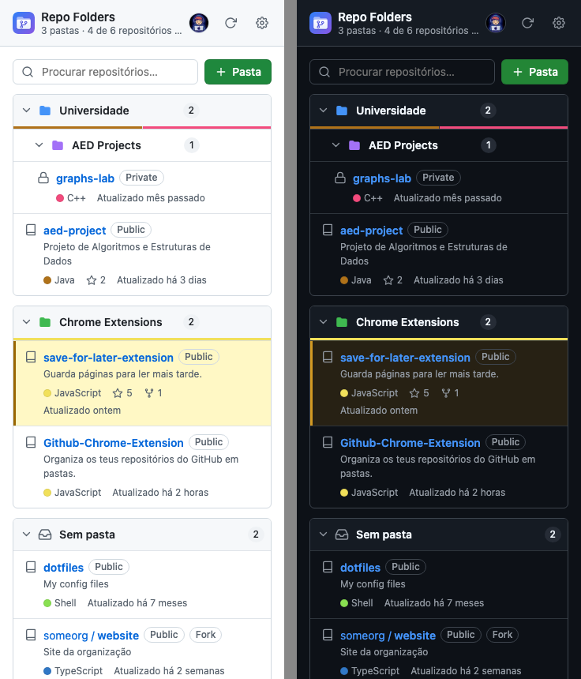

<p align="center">
  
</p>

<h1 align="center">GitHub Repo Folders</h1>

<p align="center">
  Organiza os teus repositórios do GitHub em <b>pastas e subpastas</b> — diretamente na página do teu perfil e num painel lateral do Chrome.
</p>

<p align="center">
  
  
  
  
</p>

---

O GitHub mostra todos os repositórios numa lista única. Quando tens dezenas (projetos da faculdade, trabalho, experiências, forks…) fica difícil encontrar as coisas. Esta extensão junta à lista de repositórios um painel de pastas onde arrastas cada repositório para o sítio certo. Tudo fica guardado no teu browser.

<p align="center">
  
</p>

## Índice

- [Funcionalidades](#funcionalidades)
- [Instalação](#instalação)
- [Como usar](#como-usar)
- [Token do GitHub (opcional)](#token-do-github-opcional)
- [README do perfil](#readme-do-perfil)
- [Cópia de segurança](#cópia-de-segurança-exportar--importar)
- [Privacidade e permissões](#privacidade-e-permissões)
- [Problemas comuns](#problemas-comuns)
- [Estrutura do projeto](#estrutura-do-projeto)

## Funcionalidades

**Na página do perfil** (`github.com/<utilizador>?tab=repositories`)

- 📁 Painel de **pastas e subpastas** por cima da lista de repositórios.
- 🖱️ **Arrastar e largar** repositórios da lista (incluindo os resultados de *Find a repository…*) para dentro das pastas, e pastas para dentro de outras pastas.
- 🎨 Cor própria para cada pasta, barra com as linguagens usadas e data da última atualização.
- 📊 **Colunas configuráveis**: descrição, linguagem, contribuidores, atividade do último ano, estrelas, forks, issues, licença, tópicos, tamanho, website…
- 🔎 Pesquisa dentro das pastas.
- 🔄 Botão **Sincronizar**, que lê todas as páginas da lista (não só a primeira).
- 🤝 Secção **Colaborações** com os repositórios de outras pessoas ou organizações onde participas.
- 📝 Geração de uma secção para o **README do perfil** com as tuas pastas (copiar ou publicar diretamente).

**No painel lateral** (clica no ícone da extensão)

- As mesmas pastas, disponíveis em qualquer página.
- O repositório aberto no separador atual fica destacado, para o arrumares logo.
- Pesquisa, criação, renomeação e cores de pastas, e menu "Mover para…" como alternativa ao arrastar.
- Exportar e importar as pastas em JSON.
- Tema claro e escuro, igual ao do GitHub.

As duas vistas partilham os mesmos dados: o que muda numa aparece logo na outra.

## Instalação

A extensão ainda não está na Chrome Web Store; instala-se a partir do código (demora menos de um minuto).

1. **Descarrega o código**
   - Com Git:
     ```bash
     git clone https://github.com/MCCProgrammer/Github-Chrome-Extension.git
     ```
   - Ou carrega em **Code → Download ZIP** nesta página e descomprime o ficheiro.
2. Abre `chrome://extensions` no Chrome.
3. Liga o **Modo de programador** (canto superior direito).
4. Carrega em **Carregar sem compactação** (*Load unpacked*) e escolhe a pasta do projeto (a que tem o `manifest.json`).
5. Fixa a extensão na barra: ícone do puzzle 🧩 → 📌 ao lado de *GitHub Repo Folders*.

Funciona no Chrome 114 ou mais recente e noutros browsers baseados em Chromium com suporte para painel lateral (Edge, Brave, Arc, Opera…).

### Atualizar

```bash
cd Github-Chrome-Extension
git pull
```

Depois, em `chrome://extensions`, carrega no botão ↻ da extensão e recarrega as páginas do GitHub que tiveres abertas. As tuas pastas mantêm-se.

## Como usar

### 1. Na página dos teus repositórios

1. Abre `https://github.com/<o-teu-utilizador>?tab=repositories`.
2. Por cima da lista aparece o painel **Pastas**. Carrega em **Nova pasta** e escreve um nome (Enter para confirmar).
3. **Arrasta** um repositório da lista para a pasta. Também podes usar o botão **Pasta** que aparece ao lado do nome de cada repositório.
4. Os repositórios que já estão numa pasta deixam de aparecer na lista de baixo, por isso o que fica na lista é o que ainda falta arrumar.

| Ação | Como |
| --- | --- |
| Criar subpasta | Botão 📁+ no cabeçalho da pasta |
| Tornar uma pasta subpasta de outra | Arrasta o cabeçalho de uma pasta para dentro de outra |
| Voltar a pôr uma pasta no topo | Arrasta-a para uma zona vazia do painel |
| Mudar o nome | Duplo clique no nome, ou botão ✎ |
| Mudar a cor | Clica no ícone da pasta |
| Tirar um repositório de uma pasta | Menu ⋯ → *Tirar da pasta*, ou arrasta-o para fora |
| Apagar uma pasta | Botão 🗑 — o conteúdo sobe para a pasta-mãe; **nada é apagado no GitHub** |
| Escolher a informação de cada linha | Botão **Colunas** |
| Ler todos os repositórios | Botão **Sincronizar** (faz-se sozinho na primeira visita) |

> A pesquisa *Find a repository…* do GitHub continua a funcionar: os resultados também se podem arrastar para as pastas.

### 2. No painel lateral

1. Clica no ícone da extensão na barra do Chrome para abrir o painel lateral.
2. Na primeira vez, abre as **Definições** (⚙) e escreve o teu utilizador do GitHub. Carrega em **Guardar** para importar os repositórios públicos.
3. Arrasta repositórios entre pastas, ou usa o menu ⋯ de cada linha.
4. Ao navegares no GitHub, o repositório que tens aberto aparece destacado a amarelo, para o meteres numa pasta.

## Token do GitHub (opcional)

Sem token, a extensão já faz quase tudo: lê os repositórios da página do perfil com a tua sessão do GitHub e usa a API pública (60 pedidos por hora).

O token é necessário para:

- ver repositórios **privados** no painel lateral;
- listar **colaborações** e repositórios de organizações através da API;
- **publicar diretamente** no README do perfil;
- evitar o limite de 60 pedidos por hora da API.

Como criar:

1. Vai a [**Settings → Developer settings → Fine-grained tokens → Generate new token**](https://github.com/settings/personal-access-tokens/new).
2. Em *Repository access*, escolhe **All repositories** (ou só os que quiseres).
3. Em *Permissions → Repository permissions*:
   - **Metadata**: *Read-only* (obrigatório);
   - **Contents**: *Read and write* — só se quiseres publicar o README do perfil.
4. Gera o token, copia-o e cola-o em **⚙ Definições → Personal access token** no painel lateral.

O token fica guardado apenas no `chrome.storage.local` deste browser e só é enviado para `api.github.com`.

## README do perfil

O GitHub mostra no teu perfil o README do repositório especial `<utilizador>/<utilizador>`. A extensão gera uma secção com as tuas pastas e projetos:

1. Na página dos teus repositórios, carrega em **README** (só aparece no teu próprio perfil, e quando tens pastas).
2. Escolhe as colunas e se queres incluir repositórios privados. Vês a pré-visualização tal como o GitHub a vai mostrar.
3. Depois tens duas opções:
   - **Copiar Markdown**: colas no `README.md` à mão;
   - **Publicar diretamente**: grava o ficheiro por ti (precisa do token com *Contents: Read and write*).

A secção fica entre `<!-- REPO-FOLDERS:START -->` e `<!-- REPO-FOLDERS:END -->`. Ao publicares outra vez, só esse bloco é substituído; o resto do README não é alterado.

## Cópia de segurança (exportar / importar)

As pastas ficam guardadas no browser. Para as passares para outro computador ou fazeres uma cópia de segurança:

- **⚙ Definições → Exportar** descarrega `github-repo-folders.json`;
- **⚙ Definições → Importar** carrega esse ficheiro noutro browser.

> ⚠️ Se removeres a extensão, as pastas são apagadas. Exporta-as antes.

## Privacidade e permissões

Não há servidores, análises de utilização nem rastreio. Os únicos pedidos de rede são para `github.com` (com a tua sessão) e para `api.github.com`.

| Permissão | Para quê |
| --- | --- |
| `storage` | Guardar pastas, definições e a cache dos repositórios no teu browser |
| `sidePanel` | Mostrar o painel lateral ao clicar no ícone |
| `tabs` | Saber que repositório está aberto no separador atual, para o destacar |
| `https://api.github.com/*` | Ler repositórios e colaborações, e publicar o README do perfil |
| Script em `https://github.com/*` | Desenhar o painel de pastas na página dos repositórios |

## Problemas comuns

<details>
<summary><b>O painel não aparece na página do perfil</b></summary>

Confirma que estás no separador **Repositories** (`?tab=repositories`). Se acabaste de instalar ou atualizar a extensão, recarrega a página.
</details>

<details>
<summary><b>Faltam repositórios</b></summary>

Carrega em **Sincronizar** no painel da página. A sincronização lê todas as páginas da lista, não só a primeira.
</details>

<details>
<summary><b>"Limite da API atingido"</b></summary>

Sem token, a API do GitHub só permite 60 pedidos por hora. Adiciona um token nas definições do painel lateral.
</details>

<details>
<summary><b>Não aparecem as colaborações</b></summary>

As colaborações só aparecem no teu próprio perfil. Sem token, são lidas de `github.com/settings/repositories`; com token, vêm da API e são mais completas.
</details>

<details>
<summary><b>"Publicar diretamente" está desativado</b></summary>

É preciso um token com permissão **Contents: Read and write** no repositório `<utilizador>/<utilizador>`, e esse repositório tem de existir (e ser público). O botão também fica desativado quando o README já está atualizado.
</details>

## Estrutura do projeto

```
├── manifest.json      # Configuração da extensão (Manifest V3)
├── background.js      # Service worker: pedidos à API do GitHub e abertura do painel lateral
├── content.js         # Painel de pastas na página github.com/<user>?tab=repositories
├── content.css        #   └ estilos do painel na página
├── folders-core.js    # Lógica da árvore de pastas (partilhada pelas duas vistas)
├── readme.js          # Geração da secção para o README do perfil
├── sidepanel.html     # Painel lateral
├── sidepanel.js
├── sidepanel.css
├── icons/             # Ícones (icon.svg é o original)
└── docs/              # Imagens deste README
```

O projeto não tem dependências nem passo de *build*: é JavaScript puro, carregado diretamente pelo Chrome. Para desenvolver, edita os ficheiros, carrega em ↻ em `chrome://extensions` e recarrega a página do GitHub.

## Contribuir

Sugestões e *pull requests* são bem-vindos. Abre uma [issue](https://github.com/MCCProgrammer/Github-Chrome-Extension/issues) para reportar um problema ou propor uma ideia.

## Licença

[MIT](LICENSE) © MCCarmo
