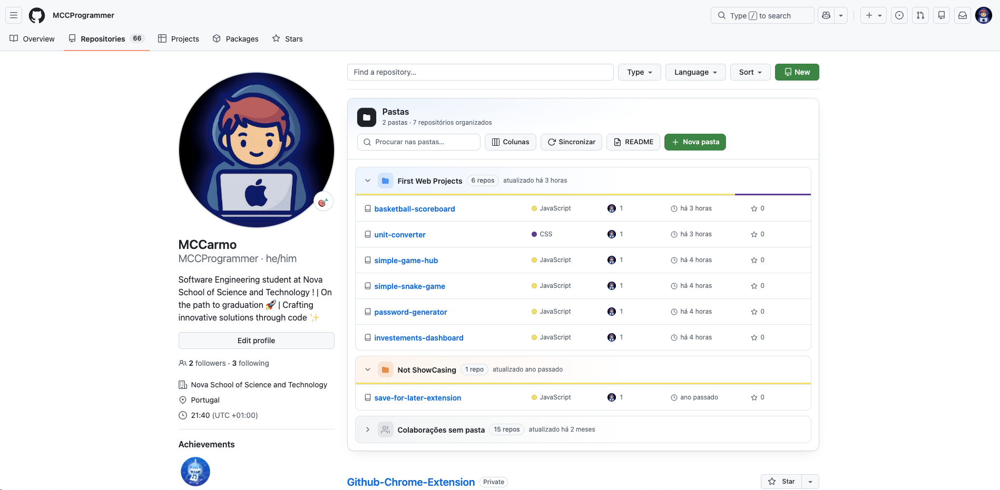

<p align="center">
  
</p>

<h1 align="center">GitHub Repo Folders</h1>

<p align="center">
  Organize your GitHub repositories into <b>folders and subfolders</b> — right on your profile page and in a Chrome side panel.
</p>

<p align="center">
  
  
  
  
</p>

---

GitHub shows all your repositories in one long list. Once you have dozens of them (school projects, work, experiments, forks…) things get hard to find. This extension adds a folders panel to your repository list where you drag each repository to the right place. There's nothing to configure: it uses the account you're signed in with on github.com, and your folders sync across computers through your Chrome profile.

<p align="center">
  <picture>
    <source media="(prefers-color-scheme: dark)" srcset="docs/screenshot-dark.png">
    
  </picture>
</p>

## Contents

- [Features](#features)
- [Installation](#installation)
- [Usage](#usage)
- [Accounts](#accounts)
- [Profile README](#profile-readme)
- [Syncing across computers](#syncing-across-computers)
- [Backup (export / import)](#backup-export--import)
- [Privacy and permissions](#privacy-and-permissions)
- [Troubleshooting](#troubleshooting)
- [Project structure](#project-structure)

## Features

**On your repositories page** (`github.com/<your-account>?tab=repositories`)

- 📁 A **folders and subfolders** panel above the repository list.
- 🖱️ **Drag and drop** repositories from the list (including *Find a repository…* search results) into folders, and folders into other folders.
- 🎨 A color per folder, a bar with the languages used and when it was last updated.
- 📊 **Configurable columns**: description, language, contributors, last year's activity, stars, forks, issues, license, topics, size, website…
- 🔎 Search inside your folders.
- 🔄 A **Sync** button that reads every page of the list, not just the first.
- 🤝 An **Unsorted collaborations** section with repositories from other people or organizations you contribute to.
- 📝 Generates a section for your **profile README** listing your folders, ready to copy.

**In the side panel** (click the extension icon)

- The same folders, available on any page, with public and private repositories.
- The repository open in the current tab is highlighted so you can file it right away.
- Search, create, rename and color folders, plus a "Move to…" menu as an alternative to dragging.
- Detects the signed-in GitHub account and switches folders when you switch accounts.
- ☁️ Folders **sync with your Chrome Google account**: on another computer they show up already organized.
- Export and import folders as JSON.
- Light and dark themes, matching GitHub.

Both views share the same data: a change in one shows up in the other right away.

## Installation

The extension isn't on the Chrome Web Store yet; you install it from source (takes under a minute).

1. **Get the code**
   - Download **github-repo-folders-vX.Y.Z.zip** from the [latest release](https://github.com/MCCProgrammer/Github-Chrome-Extension/releases/latest) and unzip it, **or**
   - clone it with Git:
     ```bash
     git clone https://github.com/MCCProgrammer/Github-Chrome-Extension.git
     ```
2. Open `chrome://extensions` in Chrome.
3. Turn on **Developer mode** (top-right corner).
4. Click **Load unpacked** and pick the project folder (the one containing `manifest.json`).
5. Pin the extension: puzzle icon 🧩 → 📌 next to *GitHub Repo Folders*.

Works in Chrome 114+ and other Chromium browsers with side panel support (Edge, Brave, Arc, Opera…).

### Updating

```bash
cd Github-Chrome-Extension
git pull
```

Then click ↻ on the extension in `chrome://extensions` and reload any open GitHub pages. Your folders are kept.

## Usage

### 1. On your repositories page

1. While signed in to GitHub, open your profile → **Repositories** (`https://github.com/<your-account>?tab=repositories`). The panel only appears on your own account's list, not on other people's profiles.
2. A **Folders** panel appears above the list. Click **New folder** and type a name (Enter to confirm).
3. **Drag** a repository from the list into the folder, or use the **Folder** button next to each repository's name.
4. Repositories already in a folder are hidden from the list below, so what's left is what still needs sorting.

| Action | How |
| --- | --- |
| Create a subfolder | 📁+ button in the folder header |
| Nest a folder inside another | Drag a folder's header into another folder |
| Move a folder back to the top | Drag it to an empty area of the panel |
| Rename | Double-click the name, or the ✎ button |
| Change color | Click the folder icon |
| Take a repository out of a folder | ⋯ menu → *Remove from folder*, or drag it out |
| Delete a folder | 🗑 button — contents move up to the parent folder; **nothing is deleted on GitHub** |
| Choose what each row shows | **Columns** button |
| Load every repository | **Sync** button (runs automatically on the first visit) |

> GitHub's *Find a repository…* search keeps working: search results can be dragged into folders too.

### 2. In the side panel

1. Click the extension icon in Chrome's toolbar to open the side panel.
2. The signed-in account is detected automatically and your repositories (including private ones) are loaded. If you're signed out, a **Sign in** button appears.
3. Drag repositories between folders, or use each row's ⋯ menu.
4. As you browse GitHub, the repository you have open is highlighted in yellow so you can file it.

## Accounts

There's no username or token to set up. The extension reads which account is signed in on github.com and uses that session to read your repository lists — which is how private repositories show up too.

- **Each account has its own folders.** If you switch accounts on GitHub (avatar menu → *Switch account*), the side panel switches to that account's folders. Switch back and the previous folders are still there.
- The in-page panel only appears on **your** account's repository list. Other people's profiles look exactly as usual.
- **⚙ Account** in the side panel shows which account was detected.

## Profile README

GitHub shows the README of the special `<your-account>/<your-account>` repository on your profile. The extension can generate a section listing your folders and projects:

1. On your repositories page, click **README** (only shown when you have folders).
2. Choose the columns and whether to include private repositories. The preview looks exactly as GitHub will render it.
3. Click **Copy Markdown** and paste it into `README.md` of `<your-account>/<your-account>` (the **Open README repository** button takes you there).

The section sits between `<!-- REPO-FOLDERS:START -->` and `<!-- REPO-FOLDERS:END -->`. To update it later, replace just that block.

## Syncing across computers

Folders are stored in `chrome.storage.sync`, which follows the Google account signed in to Chrome. On another computer you just need to:

1. Be signed in to Chrome with the same Google account, with **Extensions** sync turned on (`chrome://settings/syncSetup` → *Manage what you sync*);
2. Install the extension (see [Installation](#installation));
3. Sign in to GitHub with the same account.

Your folders show up already organized, and every change reaches your other computers within seconds. The repository list itself is re-read from GitHub on each computer.

> `manifest.json` contains a `key` that pins the extension ID (`oohheekikjbgehgidbclgfjdaneebeaa`). That's what lets Chrome recognize it as the same extension on different computers, even when loaded from source. Don't remove it.

Chrome sync allows up to 100 KB per extension, enough for hundreds of folders and thousands of repositories. If that limit is ever exceeded, folders keep being saved on the computer and simply stop syncing.

## Backup (export / import)

To keep a backup or move folders manually:

- **⚙ Account → Export folders** downloads `github-repo-folders.json` (the current account's folders);
- **⚙ Account → Import folders** loads that file in another browser.

> ⚠️ If you remove the extension and aren't using Chrome sync, your folders are deleted. Export them first.

## Privacy and permissions

No servers, no analytics, no tracking. It never asks for or stores passwords or tokens. The only network requests go to `github.com` (with the session you already have in the browser) and to the public `api.github.com` API.

| Permission | Why |
| --- | --- |
| `storage` | Store folders (synced with your Chrome Google account) and each account's repository cache |
| `sidePanel` | Show the side panel when you click the icon |
| `tabs` | Know which repository is open in the current tab, to highlight it |
| `https://github.com/*` | Detect the signed-in account and read repository lists (including private ones) |
| `https://api.github.com/*` | Extra data for public repositories (created date, size…) and the README preview |
| Script on `https://github.com/*` | Draw the folders panel on the repositories page |

## Troubleshooting

<details>
<summary><b>The panel doesn't appear on my profile</b></summary>

Make sure you're on the **Repositories** tab of **your own** account (`?tab=repositories`) and signed in. The panel doesn't appear on other people's profiles. If you just installed or updated the extension, reload the page.
</details>

<details>
<summary><b>Some repositories are missing</b></summary>

Click **Sync** in the in-page panel. Sync reads every page of the list, not just the first.
</details>

<details>
<summary><b>The side panel shows the wrong account</b></summary>

The panel re-checks the account every time it opens. If you switched accounts in another tab, close and reopen the panel, or reload a GitHub page.
</details>

<details>
<summary><b>Collaborations don't show up</b></summary>

Collaborations are read from `github.com/settings/repositories` with your session. Click **Sync** (on the page) or ↻ (in the side panel) to refresh them.
</details>

## Project structure

```
├── manifest.json      # Extension configuration (Manifest V3)
├── background.js      # Service worker: public GitHub API and opening the side panel
├── github-session.js  # Signed-in account, per-account storage and sync, reading GitHub pages
├── content.js         # Folders panel on github.com/<user>?tab=repositories
├── content.css        #   └ in-page panel styles
├── folders-core.js    # Folder tree logic (shared by both views)
├── readme.js          # Profile README section generator
├── sidepanel.html     # Side panel
├── sidepanel.js
├── sidepanel.css
├── icons/             # Icons (icon.svg is the source)
└── docs/              # Images for this README
```

No dependencies and no build step: plain JavaScript loaded directly by Chrome. To develop, edit the files, click ↻ in `chrome://extensions` and reload the GitHub page.

## Contributing

Suggestions and pull requests are welcome. Open an [issue](https://github.com/MCCProgrammer/Github-Chrome-Extension/issues) to report a bug or propose an idea.

## License

[MIT](LICENSE) © MCCarmo
