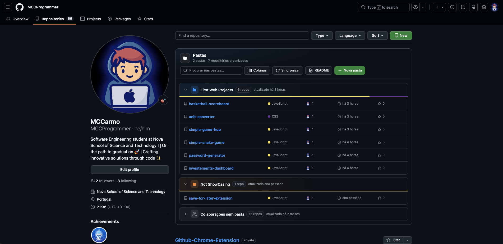

<p align="center">
  
</p>

<h1 align="center">GitHub Repo Folders</h1>

<p align="center">
  Organiza os teus repositórios do GitHub em <b>pastas e subpastas</b> — diretamente na página do teu perfil e num painel lateral do Chrome.
</p>

<p align="center">
  
  
  
  
</p>

---

O GitHub mostra todos os repositórios numa lista única. Quando tens dezenas (projetos da faculdade, trabalho, experiências, forks…) fica difícil encontrar as coisas. Esta extensão junta à lista de repositórios um painel de pastas onde arrastas cada repositório para o sítio certo. Não há nada para configurar: a extensão usa a conta com sessão iniciada no github.com e tudo fica guardado no teu browser.

<p align="center">
  
</p>

## Índice

- [Funcionalidades](#funcionalidades)
- [Instalação](#instalação)
- [Como usar](#como-usar)
- [Contas](#contas)
- [README do perfil](#readme-do-perfil)
- [Sincronização entre computadores](#sincronização-entre-computadores)
- [Cópia de segurança](#cópia-de-segurança-exportar--importar)
- [Privacidade e permissões](#privacidade-e-permissões)
- [Problemas comuns](#problemas-comuns)
- [Estrutura do projeto](#estrutura-do-projeto)

## Funcionalidades

**Na página dos teus repositórios** (`github.com/<a-tua-conta>?tab=repositories`)

- 📁 Painel de **pastas e subpastas** por cima da lista de repositórios.
- 🖱️ **Arrastar e largar** repositórios da lista (incluindo os resultados de *Find a repository…*) para dentro das pastas, e pastas para dentro de outras pastas.
- 🎨 Cor própria para cada pasta, barra com as linguagens usadas e data da última atualização.
- 📊 **Colunas configuráveis**: descrição, linguagem, contribuidores, atividade do último ano, estrelas, forks, issues, licença, tópicos, tamanho, website…
- 🔎 Pesquisa dentro das pastas.
- 🔄 Botão **Sincronizar**, que lê todas as páginas da lista (não só a primeira).
- 🤝 Secção **Colaborações** com os repositórios de outras pessoas ou organizações onde participas.
- 📝 Geração de uma secção para o **README do perfil** com as tuas pastas, pronta a copiar.

**No painel lateral** (clica no ícone da extensão)

- As mesmas pastas, disponíveis em qualquer página, com os repositórios públicos e privados.
- O repositório aberto no separador atual fica destacado, para o arrumares logo.
- Pesquisa, criação, renomeação e cores de pastas, e menu "Mover para…" como alternativa ao arrastar.
- Deteta sozinho a conta com sessão iniciada e muda de pastas quando trocas de conta.
- Exportar e importar as pastas em JSON.
- ☁️ As pastas **sincronizam com a tua conta Google do Chrome**: noutro computador aparecem já organizadas.
- Tema claro e escuro, igual ao do GitHub.

As duas vistas partilham os mesmos dados: o que muda numa aparece logo na outra.

## Instalação

A extensão ainda não está na Chrome Web Store; instala-se a partir do código (demora menos de um minuto).

1. **Descarrega o código**
   - Com Git:
     ```bash
     git clone https://github.com/MCCProgrammer/Github-Chrome-Extension.git
     ```
   - Ou carrega em **Code → Download ZIP** nesta página e descomprime o ficheiro.
2. Abre `chrome://extensions` no Chrome.
3. Liga o **Modo de programador** (canto superior direito).
4. Carrega em **Carregar sem compactação** (*Load unpacked*) e escolhe a pasta do projeto (a que tem o `manifest.json`).
5. Fixa a extensão na barra: ícone do puzzle 🧩 → 📌 ao lado de *GitHub Repo Folders*.

Funciona no Chrome 114 ou mais recente e noutros browsers baseados em Chromium com suporte para painel lateral (Edge, Brave, Arc, Opera…).

### Atualizar

```bash
cd Github-Chrome-Extension
git pull
```

Depois, em `chrome://extensions`, carrega no botão ↻ da extensão e recarrega as páginas do GitHub que tiveres abertas. As tuas pastas mantêm-se.

## Como usar

### 1. Na página dos teus repositórios

1. Com sessão iniciada no GitHub, abre o teu perfil → **Repositories** (`https://github.com/<a-tua-conta>?tab=repositories`). O painel só aparece na lista da tua própria conta, não nos perfis de outras pessoas.
2. Por cima da lista aparece o painel **Pastas**. Carrega em **Nova pasta** e escreve um nome (Enter para confirmar).
3. **Arrasta** um repositório da lista para a pasta. Também podes usar o botão **Pasta** que aparece ao lado do nome de cada repositório.
4. Os repositórios que já estão numa pasta deixam de aparecer na lista de baixo, por isso o que fica na lista é o que ainda falta arrumar.

| Ação | Como |
| --- | --- |
| Criar subpasta | Botão 📁+ no cabeçalho da pasta |
| Tornar uma pasta subpasta de outra | Arrasta o cabeçalho de uma pasta para dentro de outra |
| Voltar a pôr uma pasta no topo | Arrasta-a para uma zona vazia do painel |
| Mudar o nome | Duplo clique no nome, ou botão ✎ |
| Mudar a cor | Clica no ícone da pasta |
| Tirar um repositório de uma pasta | Menu ⋯ → *Tirar da pasta*, ou arrasta-o para fora |
| Apagar uma pasta | Botão 🗑 — o conteúdo sobe para a pasta-mãe; **nada é apagado no GitHub** |
| Escolher a informação de cada linha | Botão **Colunas** |
| Ler todos os repositórios | Botão **Sincronizar** (faz-se sozinho na primeira visita) |

> A pesquisa *Find a repository…* do GitHub continua a funcionar: os resultados também se podem arrastar para as pastas.

### 2. No painel lateral

1. Clica no ícone da extensão na barra do Chrome para abrir o painel lateral.
2. A conta é detetada automaticamente e os repositórios (incluindo os privados) são carregados. Se não tiveres sessão iniciada, aparece um botão para **Iniciar sessão**.
3. Arrasta repositórios entre pastas, ou usa o menu ⋯ de cada linha.
4. Ao navegares no GitHub, o repositório que tens aberto aparece destacado a amarelo, para o meteres numa pasta.

## Contas

Não há utilizador nem token para configurar. A extensão lê a conta com sessão iniciada no github.com e usa essa sessão para ler as listas de repositórios. É assim que aparecem também os repositórios privados.

- **Cada conta tem as suas pastas.** Se trocares de conta no GitHub (menu do avatar → *Switch account*), o painel lateral passa para as pastas dessa conta. Ao voltares à conta anterior, as pastas dela estão lá.
- O painel na página só aparece na lista de repositórios da **tua** conta. Nos perfis de outras pessoas o GitHub fica como sempre.
- Em **⚙ Conta** no painel lateral vês qual é a conta detetada.

## README do perfil

O GitHub mostra no teu perfil o README do repositório especial `<utilizador>/<utilizador>`. A extensão gera uma secção com as tuas pastas e projetos:

1. Na página dos teus repositórios, carrega em **README** (só aparece no teu próprio perfil, e quando tens pastas).
2. Escolhe as colunas e se queres incluir repositórios privados. Vês a pré-visualização tal como o GitHub a vai mostrar.
3. Carrega em **Copiar Markdown** e cola no `README.md` do repositório `<a-tua-conta>/<a-tua-conta>` (o botão **Abrir repositório do README** leva-te lá).

A secção fica entre `<!-- REPO-FOLDERS:START -->` e `<!-- REPO-FOLDERS:END -->`. Para atualizar mais tarde, substitui só esse bloco.

## Sincronização entre computadores

As pastas são guardadas no `chrome.storage.sync`, que acompanha a conta Google com sessão iniciada no Chrome. Noutro computador basta:

1. Ter sessão iniciada no Chrome com a mesma conta Google e a sincronização de **Extensões** ligada (`chrome://settings/syncSetup` → *Gerir o que sincronizas*);
2. Instalar a extensão (ver [Instalação](#instalação));
3. Iniciar sessão no GitHub com a mesma conta.

As pastas aparecem já organizadas e cada alteração passa para os outros computadores em poucos segundos. A lista de repositórios é lida outra vez do GitHub em cada computador.

> O `manifest.json` tem uma `key` que fixa o ID da extensão (`oohheekikjbgehgidbclgfjdaneebeaa`). É isso que permite ao Chrome reconhecer a mesma extensão em computadores diferentes, mesmo instalada a partir do código. Não a removas.

O sync do Chrome guarda até 100 KB por extensão, o que chega para centenas de pastas e milhares de repositórios. Se esse limite for ultrapassado, as pastas continuam guardadas no computador e deixam de sincronizar.

## Cópia de segurança (exportar / importar)

As pastas ficam guardadas no browser. Para as passares para outro computador ou fazeres uma cópia de segurança:

- **⚙ Conta → Exportar pastas** descarrega `github-repo-folders.json` (as pastas da conta atual);
- **⚙ Conta → Importar pastas** carrega esse ficheiro noutro browser.

> ⚠️ Se removeres a extensão e não usares a sincronização do Chrome, as pastas são apagadas. Exporta-as antes.

## Privacidade e permissões

Não há servidores, análises de utilização nem rastreio. Não pede nem guarda palavras-passe ou tokens. Os únicos pedidos de rede são para `github.com` (com a sessão que já tens no browser) e para a API pública `api.github.com`.

| Permissão | Para quê |
| --- | --- |
| `storage` | Guardar as pastas (sincronizadas com a tua conta Google do Chrome) e a cache dos repositórios de cada conta |
| `sidePanel` | Mostrar o painel lateral ao clicar no ícone |
| `tabs` | Saber que repositório está aberto no separador atual, para o destacar |
| `https://github.com/*` | Detetar a conta com sessão iniciada e ler as listas de repositórios (incluindo privados) |
| `https://api.github.com/*` | Dados extra de repositórios públicos (data de criação, tamanho…) e pré-visualização do README |
| Script em `https://github.com/*` | Desenhar o painel de pastas na página dos repositórios |

## Problemas comuns

<details>
<summary><b>O painel não aparece na página do perfil</b></summary>

Confirma que estás no separador **Repositories** da **tua** conta (`?tab=repositories`) e com sessão iniciada. O painel não aparece nos perfis de outras pessoas. Se acabaste de instalar ou atualizar a extensão, recarrega a página.
</details>

<details>
<summary><b>Faltam repositórios</b></summary>

Carrega em **Sincronizar** no painel da página. A sincronização lê todas as páginas da lista, não só a primeira.
</details>

<details>
<summary><b>O painel lateral mostra a conta errada</b></summary>

O painel confirma a conta sempre que é aberto. Se trocaste de conta noutro separador, fecha e volta a abrir o painel, ou recarrega uma página do GitHub.
</details>

<details>
<summary><b>Não aparecem as colaborações</b></summary>

As colaborações são lidas de `github.com/settings/repositories` com a tua sessão. Carrega em **Sincronizar** (na página) ou em ↻ (no painel lateral) para as atualizar.
</details>

## Estrutura do projeto

```
├── manifest.json      # Configuração da extensão (Manifest V3)
├── background.js      # Service worker: API pública do GitHub e abertura do painel lateral
├── github-session.js  # Conta com sessão iniciada, dados por conta e leitura das páginas do GitHub
├── content.js         # Painel de pastas na página github.com/<user>?tab=repositories
├── content.css        #   └ estilos do painel na página
├── folders-core.js    # Lógica da árvore de pastas (partilhada pelas duas vistas)
├── readme.js          # Geração da secção para o README do perfil
├── sidepanel.html     # Painel lateral
├── sidepanel.js
├── sidepanel.css
├── icons/             # Ícones (icon.svg é o original)
└── docs/              # Imagens deste README
```

O projeto não tem dependências nem passo de *build*: é JavaScript puro, carregado diretamente pelo Chrome. Para desenvolver, edita os ficheiros, carrega em ↻ em `chrome://extensions` e recarrega a página do GitHub.

## Contribuir

Sugestões e *pull requests* são bem-vindos. Abre uma [issue](https://github.com/MCCProgrammer/Github-Chrome-Extension/issues) para reportar um problema ou propor uma ideia.

## Licença

[MIT](LICENSE) © MCCarmo
